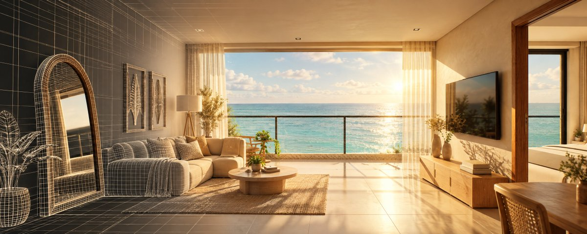
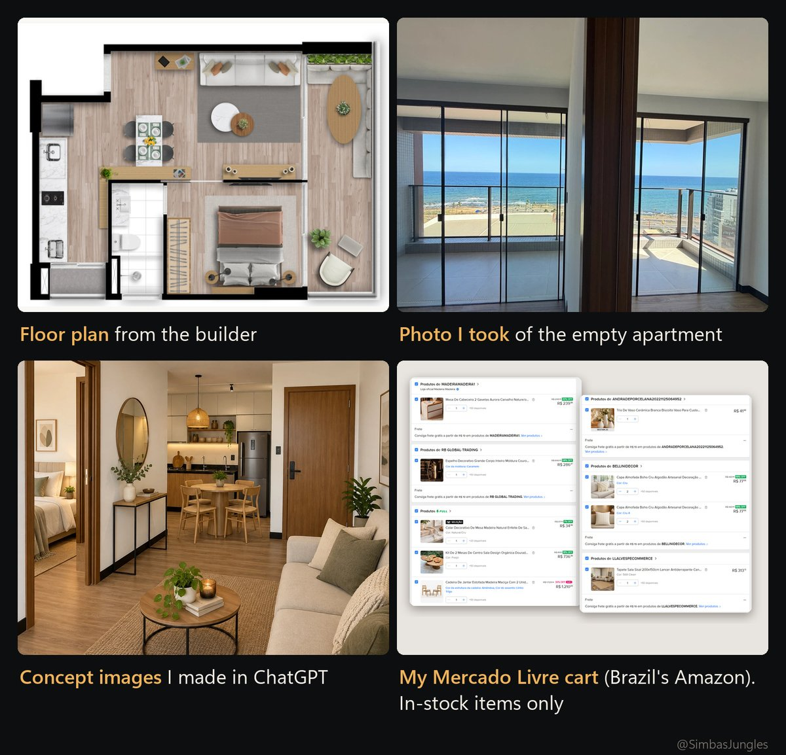
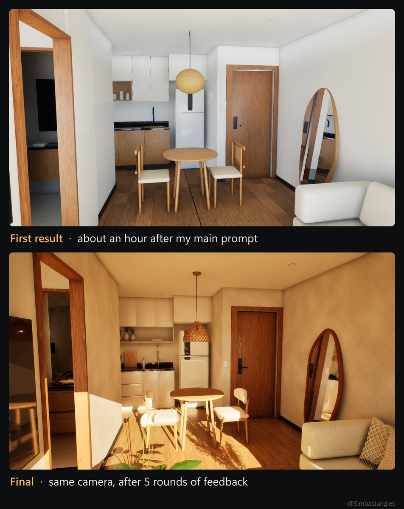
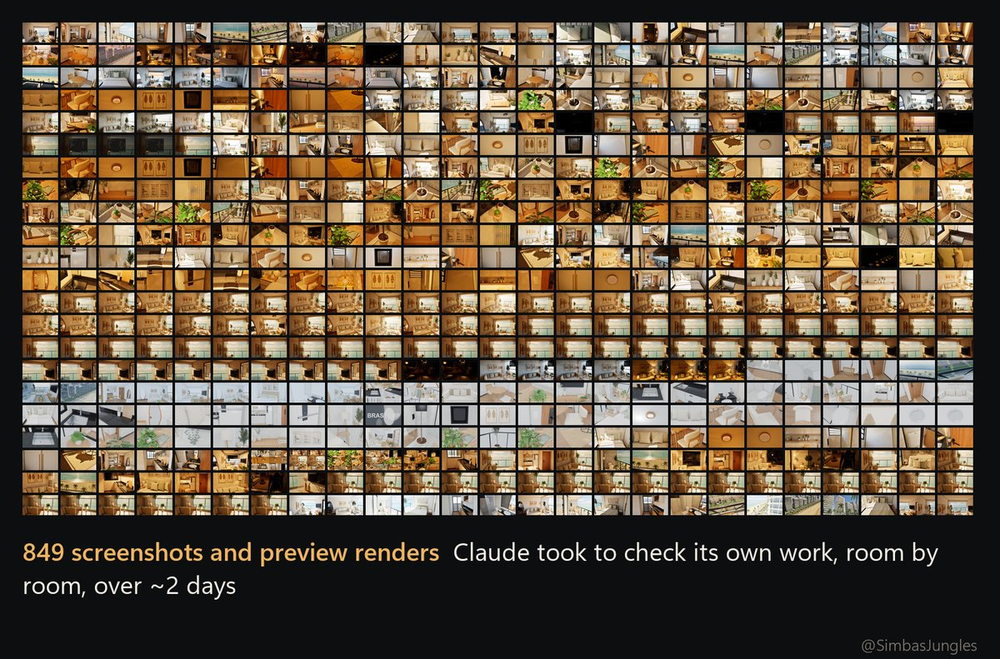
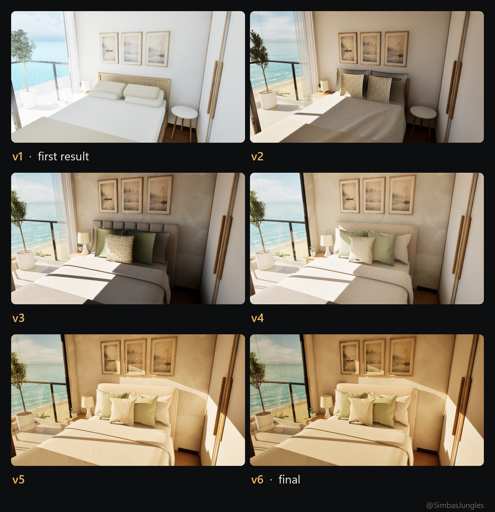
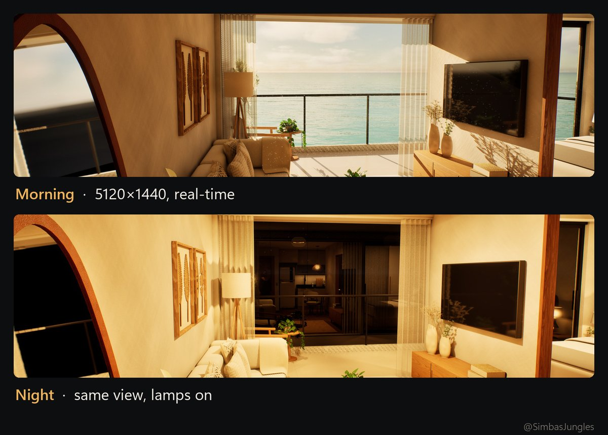
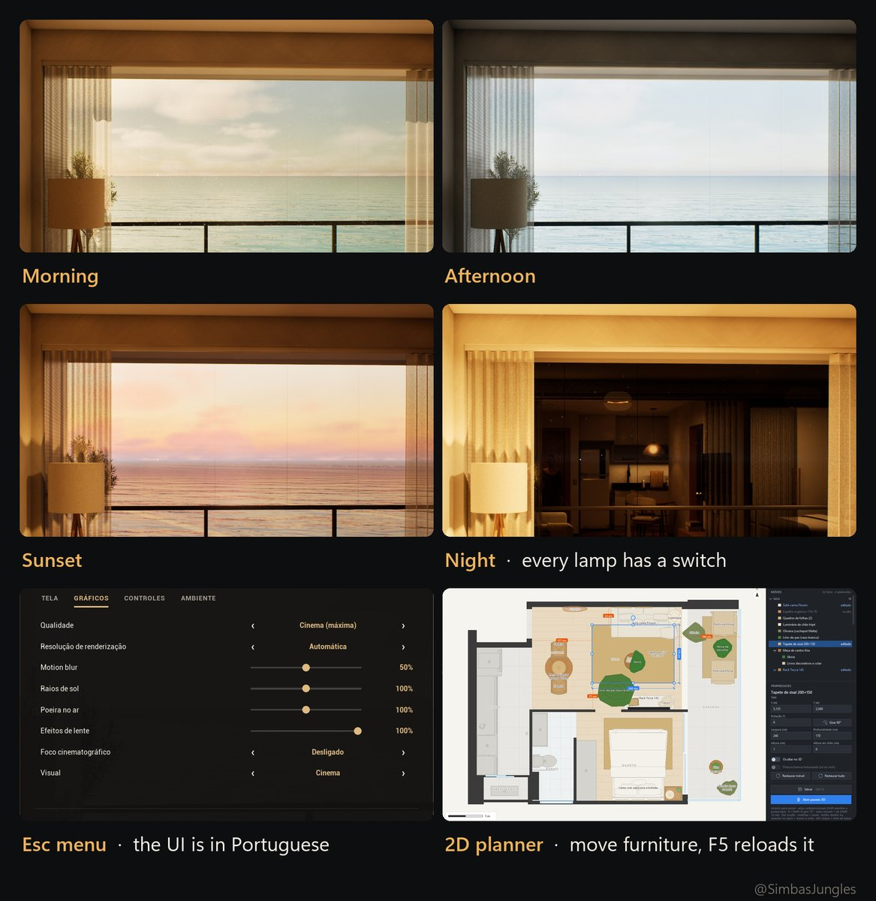
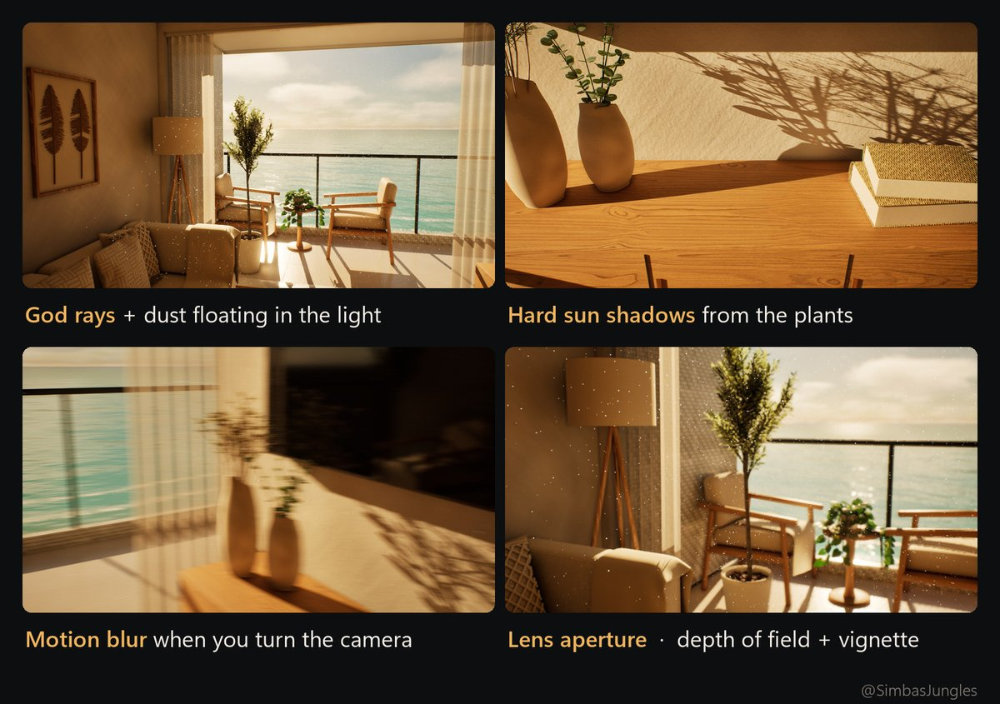
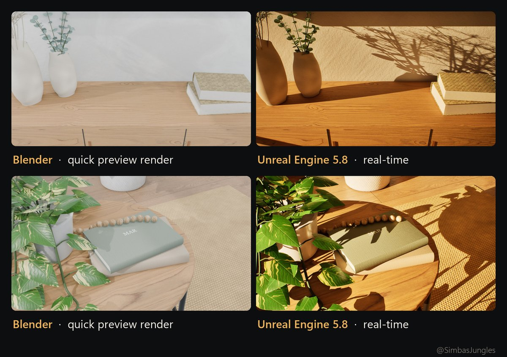

# Image inventory and text summaries

Numbers below are inventory IDs; source.json preserves media IDs. Notes are paraphrases from visual inspection, not verbatim OCR.

## 00

Cover: apartment scene combining wireframe geometry and finished lighting.

[Original image](https://pbs.twimg.com/media/HUWzv0fWYAAPZsK.jpg)

## 01

Inputs: architectural plan, empty-room photograph, generated design reference and shopping-cart captures. The purchase constraint is available furniture.

[Original image](https://pbs.twimg.com/media/HUW0kIzW4AALRAj.jpg)

## 02

Prompt screenshot: asks for a realistic, well-lit apartment modeled in Blender and made walkable in Unreal using the supplied references. A credential is visibly redacted.

[Original image](https://pbs.twimg.com/media/HUW1xjyXcAAxxSo.jpg)

Long screenshot text summarized; original not copied.

## 03

Early and later room views from the same viewpoint illustrate refinement through five feedback rounds.

[Original image](https://pbs.twimg.com/media/HUWxE6FX0AAdWfr.jpg)

## 04

A contact sheet presents the author's claimed 849 visual checks across roughly two days; the count is a caption claim, not independently counted.

[Original image](https://pbs.twimg.com/media/HUW249yWkAAib6k.jpg)

## 05

Six bedroom versions show progressively revised furnishings, textures and illumination.

[Original image](https://pbs.twimg.com/media/HUW2GLbWsAAsDyt.jpg)

## 06

Two matching living-room views compare morning illumination with lamps at night.

[Original image](https://pbs.twimg.com/media/HUW3Aq4XUAA1QBZ.jpg)

## 07

Demonstrates four lighting states, a Portuguese settings menu and a separate furniture-layout editor. The caption identifies F5 as the reload action.

[Original image](https://pbs.twimg.com/media/HUW2qjYWcAAffhP.jpg)

## 08

Performance screenshot: request targets 60 FPS while retaining visual quality. Response describes time-dependent glass reflections, fewer shadow rays and adaptive resolution. Reported rates change from 27–43 to 64–65 FPS at 5120×1440 on an RTX 4090.

[Original image](https://pbs.twimg.com/media/HUW2jOCXUAApDM8.jpg)

Long screenshot text summarized; original not copied.

## 09

Feedback screenshot: requests fixes for intersecting cushions, an unrealistic rug edge, artificial-looking pillows and flat surfaces; later asks for detailed foliage, illuminated dust and stronger cinematic lighting.

[Original image](https://pbs.twimg.com/media/HUW1-JMXsAA6EX_.jpg)

Long screenshot text summarized; original not copied.

## 10

Effects examples show sunbeams with particles, plant shadows, camera-turn blur and depth-of-field/vignette.

[Original image](https://pbs.twimg.com/media/HUW2NepWIAApv3e.jpg)

## 11

Paired Blender previews and Unreal scenes illustrate the contribution of lighting and shadows.

[Original image](https://pbs.twimg.com/media/HUW2xshXEAAGtVV.jpg)

